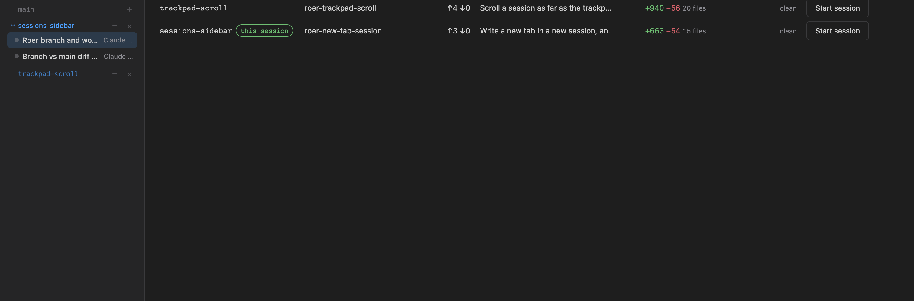
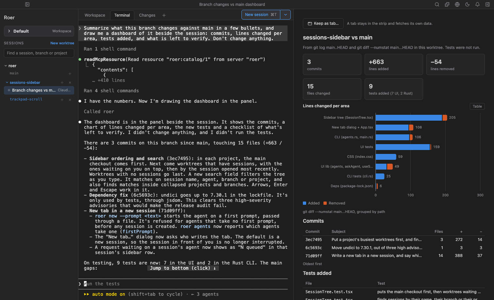
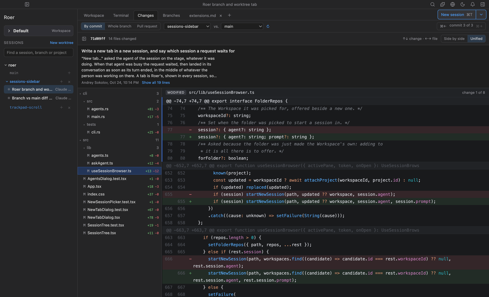
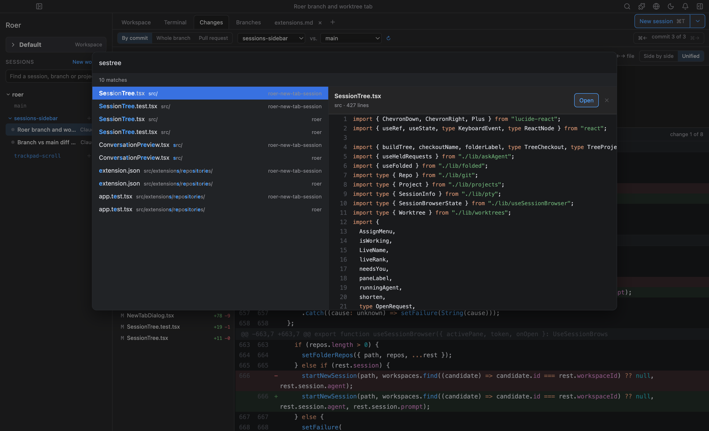
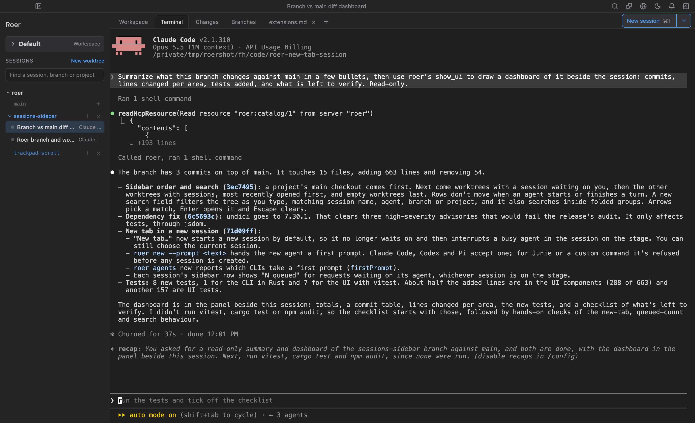
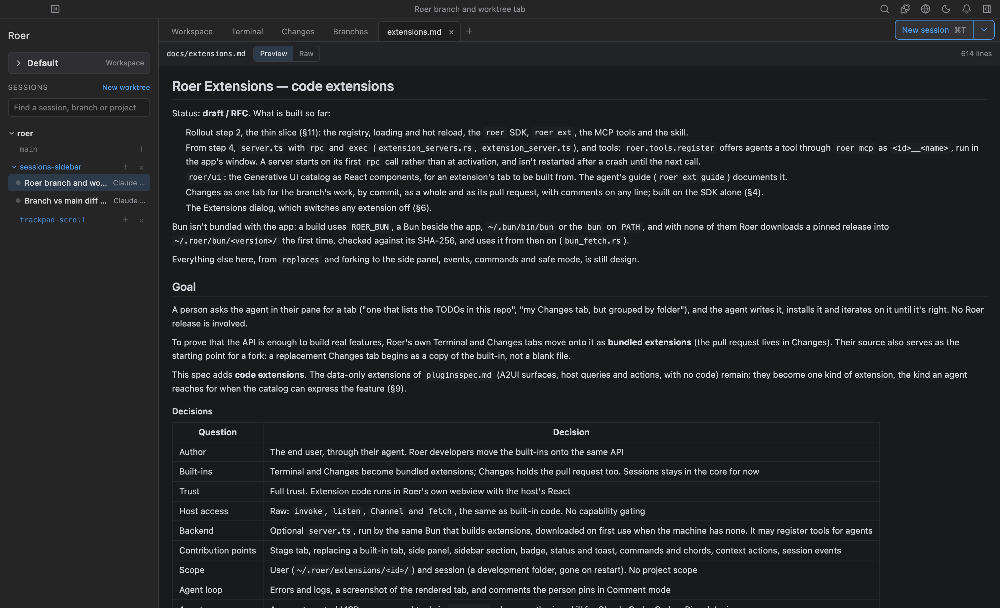

# roer

Roer is a workspace for terminal coding agents.

- Run any agent CLI.
- Review its changes, from diff to merged PR.
- Let it draw the UI you need, beside the session.

**[Download the latest release](https://github.com/JetBrains/roer/releases/latest)** for macOS, Linux or Windows. Installing, the MCP server and the skills: [docs/install.md](docs/install.md).

**Extensions.** Ask your agent for a tab ("make me a tab that…"), or click **+** in the strip, and it writes one from Roer's own UI components. By default a new session writes it, so the agent you are working with keeps its turn. Roer reloads the tab on every save. Here, a tab of every branch and worktree against main, with a button to start a session in each.

**Generative UI.** The agent draws what you need beside the session: a dashboard, a plan to approve, a diagram. A view you keep coming back to can become a tab.

**Changes and pull requests.** Step through a branch's commits against its base and each commit's files. Commit from there, with Claude drafting the message. Open the PR, request a Copilot review, decide on each review thread right on the diff and send the decisions to the session, then merge. Arrow keys and ⌘+arrows step through commits and files.

**Search** (`⇧⌘O`). One fuzzy search for sessions, files and past conversations, with a preview of what it found. The sidebar filters sessions, branches and projects as you type, too.

**Sessions that move.** A running `claude` hands off from your terminal to the app without restarting. Sessions live in tmux on a private socket, so they outlive the app. Start Claude Code, Codex, Pi or Junie, in a worktree of its own if you like, or [save an agent](docs/saved-agents.md) with a model, effort and instructions.

**Markdown preview.** Open any Markdown file, from search or the diff, and read it rendered.

More: [extensions](docs/extensions.md) · [running Roer on a server](docs/self-hosting.md).
